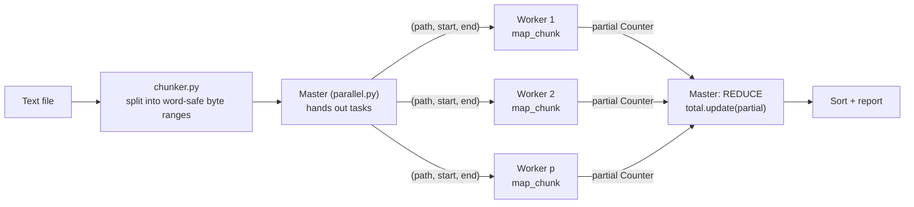

# LexiCount – Code Walkthrough

This guide explains, in plain language, what every file does and why, so that every
team member can explain the code during the presentation. Read it top to bottom once;
the order follows the flow of data through the program.

---

## 1. `tokenizer.py` – what is a "word"?

* **What:** one function, `count_words(data: bytes)`, used by *both* versions.
* **How:** the regex `rb"[A-Za-z]+"` finds every run of ASCII letters in the raw bytes.
  We first count the words exactly as written (`The`, `THE`, `the` separately, fast C code
  inside `Counter`), then merge the spellings into one lowercase key. Lowercasing a few
  thousand distinct keys is much cheaper than lowercasing 100 MB of text.
* **Why bytes, not text?** Every byte that is not a letter is a delimiter – including the
  bytes of UTF-8 characters such as `é` or emoji (all ≥ 0x80). So we never need to decode
  the file, and a chunk may end at *any* non-letter byte without breaking a word or a
  multibyte character's meaning for our definition.
* **Design choice:** `don't` → `don` + `t`. Simple, and identical in every chunk.
* `LETTER_BYTES` / `is_letter` are shared with the chunker so both use the same definition.

## 2. `sequential.py` – the baseline

* Reads the whole file in binary, calls `count_words`, sorts by frequency.
* Measures `read_time`, `count_time`, `sort_time`, `total_time` with `time.perf_counter()`
  (a high-resolution clock meant for measuring durations).
* Its result is the "ground truth"; its time is `T_seq` in the speedup formula.
* `sort_by_frequency` returns a Counter ordered from most to least frequent. Key order does
  not affect `==`, so correctness checks are unaffected.

## 3. `chunker.py` – PARTITIONING and AGGLOMERATION

* **Problem:** if we cut a file every 4 MB blindly, we may cut `hel|lo` into two "words".
* **Algorithm (`compute_chunks`):**
  1. start = 0; jump to start + chunk size.
  2. `find_boundary` reads forward (256 bytes at a time) until it finds a **non-letter** byte.
  3. That position is the end of this chunk *and* the start of the next one.
  4. Repeat until the end of the file.
* **Guarantees:** chunks are contiguous and non-overlapping → no byte skipped, no byte
  counted twice, no word split. Edge cases: empty file → `[]`; small file → one chunk;
  a giant word longer than the chunk → that chunk just grows; no final delimiter → last
  chunk ends at the file size.
* **Agglomeration:** grouping millions of words into a few dozen MB-sized tasks keeps
  the per-task overhead (sending a task, returning a result) small.

## 4. `parallel.py` – MapReduce, master-worker

* **Master** = the main process. **Workers** = processes in `multiprocessing.Pool`.
* **Why processes, not threads?** CPython's Global Interpreter Lock (GIL) allows only one
  thread to execute Python code at a time. Word counting is CPU-bound, so threads would
  take turns on one core. Processes each have their own interpreter and GIL.
* **Tasks:** `build_tasks` yields `(path, start, end, data)`.
  * `offset` mode: `data=None`; the worker opens the file, seeks and reads its own range.
    Only three numbers travel through the pipe → minimal communication.
  * `send` mode: the master reads the bytes and pickles them to the worker → extra copying.
* **MAP (`map_chunk`):** count the words of one chunk and return a `Counter` (a *combiner*:
  a few thousand `(word, count)` pairs instead of millions of words), plus the time spent
  and the worker's PID for the load-distribution report.
* **LOAD BALANCING:** many more chunks than workers + `imap_unordered(..., chunksize=1)`.
  Each worker asks for a new chunk as soon as it finishes (dynamic scheduling), so a slow
  worker never holds everybody up for long.
* **REDUCE:** `total.update(partial)` as each result arrives (in place, O(unique words)).
  `sum(counters, Counter())` would create a new Counter at every step.
* **SYNCHRONIZATION:** the `for` loop ends only after *all* results arrive; `close()` +
  `join()` wait for workers to exit; the `with Pool` block cleans up even on errors.
* **Timing breakdown:** pool startup, partition, map+reduce, pool shutdown, sort, total.
* Requesting more workers than cores prints a warning but does not crash.

## 5. `metrics.py` – the formulas

`speedup`, `efficiency`, `karp_flatt`, `amdahl_speedup` – one line each, shared by the CLI,
the benchmark and the charts so every number is computed the same way.

## 6. `main.py` – the CLI report

1. Parse/validate arguments (`argparse`, custom `positive_int` / `positive_float`).
2. Print the header (file size, cores, workers, chunk count).
3. Run sequential → print totals and top-N table.
4. Run parallel → same, plus timing breakdown and per-PID load distribution.
5. **Correctness:** compare the *full* Counters; on mismatch list the first differing words.
6. **Performance:** speedup, efficiency, Karp-Flatt serial fraction, Amdahl predictions for
   other worker counts, and an automatically written interpretation paragraph.
7. Save the top words to `results/top_words.csv`.

Errors such as a missing file produce `ERROR: ...` and exit code 1, not a traceback.

## 7. `dataset_generator.py` – test data, offline

* If `data/seed.txt` exists (e.g. a Gutenberg book) it is repeated to the target size.
* Otherwise: a built-in vocabulary (~2,500 words: function words, contractions, nouns,
  verbs with -s/-ed/-ing forms, adjectives) is sampled with a **Zipf distribution**
  (rank-r word has weight 1/r^1.07, like real English). Sentences get capitals, commas,
  end punctuation and line breaks. `random.seed(42)` makes files reproducible.
* For speed, 40,000 sentences are pre-built and then randomly combined into the file.

## 8. `benchmark.py` – experiments

* **A** strong scaling, **B** data scaling, **C** chunk size, **D** offset vs send.
* Each configuration: 1 warm-up run (discarded, warms the OS file cache) + 5 measured runs
  → mean, median, standard deviation; every run is checked against the sequential Counter.
* The sequential baseline is measured once per file size and reused.
* Results + machine info (CPU, cores, RAM, OS, Python) → `results/benchmark_results.json`/`.csv`.

## 9. `visualize.py` – charts

Reads the JSON and writes seven 300-dpi PNGs. The Amdahl curve uses the average Karp-Flatt
serial fraction of Experiment A; the crossover point in `time_vs_file_size.png` is
interpolated (log scale) between the last size where parallel was slower and the first
where it was faster.

## 10. `dashboard.py` – optional live demo

Streamlit page: pick/generate a dataset, choose workers/chunk/mode, press **Run analysis**,
see both times, speedup/efficiency, the correctness badge, a top-N bar chart, the timing
breakdown, the load distribution, and the saved benchmark charts. Start it with
`python -m streamlit run dashboard.py` (the `-m` form is the safest with multiprocessing).

## 11. `tests/test_correctness.py`

`unittest` suite: chunker guarantees (contiguous, full coverage, never inside a word) and
parallel == sequential for boundary words, 16-byte chunks, empty/punctuation-only/single-word
files, a word longer than the chunk, UTF-8 + CRLF, worker counts 1/2/3/8 and both modes.

---

## Likely panel questions

**1. Why processes and not threads?**
Because of the GIL: in CPython only one thread runs Python bytecode at a time, so CPU-bound
counting with threads would not get faster. Each process has its own interpreter and GIL,
so the OS can run them on different cores truly in parallel.

**2. How do you avoid splitting words between chunks?**
The chunker jumps ahead by the chunk size and then moves forward until it finds a non-letter
byte. Cuts only happen on delimiters, and chunks are contiguous and non-overlapping, so every
word lies entirely inside exactly one chunk. The unit tests check this for chunk sizes down
to 1 byte.

**3. Why is efficiency below 100%?**
Not all work is parallel: starting the processes, partitioning, sending tasks/results,
merging Counters and sorting are done by the master or are pure overhead. Amdahl's Law says
this serial part limits the speedup. On this laptop there is a second reason: the CPU has
4 physical cores with 2 hardware threads each (SMT), so beyond 4 workers the "extra cores"
share execution units and add much less speed. Turbo frequency also drops when all cores
are busy.

**4. Why is the parallel version slower on small files?**
Creating a process pool costs a fixed amount of time (on Windows each worker starts a new
Python interpreter and imports our modules – a few hundred milliseconds). For a 1 MB file
the counting itself takes only milliseconds, so the overhead dominates. Experiment B shows
the crossover size where parallelism starts paying off.

**5. What is the difference between "offset" and "send" mode?**
In offset mode the master sends only `(path, start, end)` and each worker reads its own bytes
from disk (OS cache). In send mode the master reads the bytes and pushes them through the
inter-process pipe, which means pickling, copying and the master doing all the reading
serially. Experiment D measures this communication overhead.

**6. Why many small chunks instead of exactly one chunk per worker?**
Load balancing. With one big chunk per worker, everyone waits for the slowest one.
With many chunks and `imap_unordered(chunksize=1)`, a free worker immediately takes the
next chunk. But chunks that are too small add per-task overhead – Experiment C shows the
trade-off (agglomeration).

**7. How do you know the parallel result is correct?**
We compare the *entire* Counter (every word and count) with the sequential result in
`main.py`, in every benchmark run, and in the unit tests (including tricky edge cases).

**8. Why do workers return a Counter instead of a list of words?**
That is the MapReduce *combiner*: aggregating locally shrinks each result from millions of
words to a few thousand pairs, reducing communication and the master's reduce work.

**9. Why `total.update(partial)` and not `sum(counters, Counter())`?**
`update` adds into one existing Counter in place, and it can start while other workers are
still busy. `sum` creates a brand-new Counter on every addition (copying everything again)
and needs all results first.

**10. What is the Karp-Flatt metric and what does it tell you?**
`e = (1/S − 1/p) / (1 − 1/p)` estimates the serial fraction from a measured speedup. If `e`
stays roughly constant as `p` grows, the limit is the inherent serial part (Amdahl). If `e`
grows with `p`, overhead grows with the number of processes (startup, communication,
contention). Its reciprocal `1/e` is the maximum speedup we could ever reach.

**Bonus – why `if __name__ == "__main__":`?** On Windows and macOS, `multiprocessing` uses
*spawn*: each worker starts a fresh interpreter and imports the main script. Without the
guard, every worker would start the whole program again (and create its own pool).

**Bonus – is there shared memory between workers?** No. Each worker receives its task,
works on private data and returns a result. There is no global mutable state, so no locks
are needed; the only synchronization is the master waiting for results.
